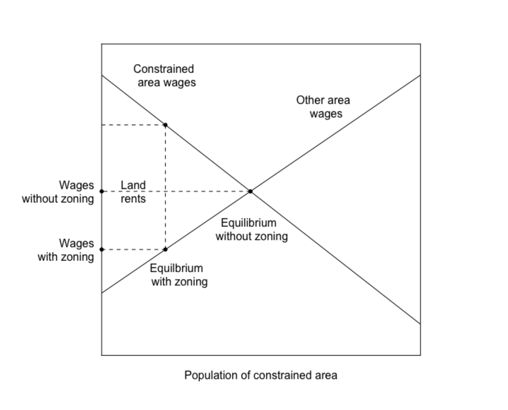

```{r libraries, include=FALSE}
knitr::opts_chunk$set(echo = FALSE, warning = FALSE, message = FALSE)
library(haven)
library(tidyverse)
library(sf)
library(srvyr)
library(survey)
theme_set(theme_bw() +
  theme(
    text = element_text(size = 20),
    strip.background = element_blank(),
    legend.title = element_blank()
  ))
library(knitr)
here::i_am("_posts/2025-09-07-housing-economics-2/housing-economics-2.Rmd")
data_path <- here::here("_posts/2025-09-07-housing-economics-2/data")
# Cost model + AHS loader helpers (Glaeser & Gyourko replication).
source(here::here("_posts/2025-09-07-housing-economics-2/R/housing_helpers.R"))
# Compact tabbed table/chart panel widget (no xaringanExtra dependency).
source(here::here("_posts/2025-09-07-housing-economics-2/R/panelset.R"))
# Mapping data brought from
# https://www.nhgis.org/1980-block-boundaries
# Wharton Residential Land use index sourced from
# https://real-faculty.wharton.upenn.edu/gyourko/land-use-survey/
```

```{r panelset-assets, results='asis'}
panelset_init()
```

# From Theory To Practice

In the first post of this series examining housing markets, we explored the
theory underlying housing markets including how houses filter from higher cost
markets to lower, as well as the impact on the market price when the
construction of new housing is restricted. In this post, we're moving from theory
to practice by studying [@glaeser2018economic] and the related material in 
[@glaeser2025america].  [@glaeser2018economic] examines the
following 3 high level ideas in detail in the US housing market:

1.  Are housing markets -- housing supply specifically -- operating
    efficiently? 
2.  If not, what might explain the lack of efficiency in?
3.  And, what are the broader consequences of this lack of efficiency across the
    economy?

```{r fig-welfare, echo=FALSE, fig.alt="Diagram of wages in a zoning-constrained area and in other areas as the constrained area's population changes, showing equilibrium with and without zoning and the land rents between them.", fig.cap="Welfare consequences of restricting development in a productive market. Source: @glaeser2018economic."}

```

<aside>
This figure illustrates some of the consequences of housing market
inefficiencies: when zoning restricts how many people can live in a productive
area, wages and land rents diverge from their unconstrained equilibrium.
</aside>

We'll work through each of these piece by piece and deconstruct the
author's arguments, digging into the author's data and methods for each
question.

# Are Housing Markets Operating Efficiently?

To answer the first question, the authors compare construction cost to the
market price at which a house sells. This speaks to a fundamental economic
principle defining the properties of efficient markets - in a perfectly
efficient market the market price is equal to the cost of production. The authors can take for granted that their econ savvy reader have
the background to understand the logic underlying this argument but if you'd
like a reference to refresh yourself I'd encourage checking out this wikipedia
[article](https://en.wikipedia.org/wiki/Competition_\(economics\)#Perfect_competition)
and/or this khan academy
[piece](https://www.khanacademy.org/economics-finance-domain/microeconomics/perfect-competition-topic/perfect-competition/a/perfect-competition-and-why-it-matters-cnx).

In order to come up with a production cost, the authors put together the
following model consisting of 3 quantities:

1.  The land value the house will reside on ($L$),
2.  The cost of constructing the house on the land ($CC$) and
3.  The profit needed to compensate the construction firm for building the house
    ($EP$)

These three components combine to define the minimum profitable
production cost ($MPPC$) in the following manner:

$$ 
MPPC = (L + CC)EP,
$$

Where EP is defined as some scalar inflation factor, $EP > 1$, so that
if $EP=1$, there's no profit and any value above represents the
additional portion of the cost that returns to the firm.

To fill in this equation the authors take the following strategy:

1.  Using a rule of thumb from an "ad-hoc survey" of home builders, the authors
    assume $L \leq .2 (L +CC)$ or $4L \leq CC$.
2.  Physical construction costs are taken from a company -- [R.S.
    Means](https://www.rsmeans.com/?srsltid=AfmBOopn2waitkQ0_5LwatHT5pHZIUorFAWiF2gMAyhx6xN-kbW-mw7H)
    -- which compiles data on the physical construction costs for
    different types of housing units across several US housing markets.
    -   An "economy-quality home" construction costs are \~ 140K for a
        2K sq. ft. home. In cheaper markets, 180K in more expensive
        markets.
    -   According to the authors, these costs haven't changed much over time.
3.  The authors assume $EP = 1.17$. Homebuilders' profit margins on land and
    construction costs run 9-11% per year across the cycle. Because operating
    costs take roughly 35-40% of a builder's gross margin, this implies a gross
    margin of about 17%, so $EP = 1 + 0.17 = 1.17$.

Putting this together, the authors determine that an "efficient" housing
market should be able to supply an 2000 sq. ft. "economy" house for \~
\$200K in a low construction cost market and \~ \$265K in the higher
construction cost markets.

Plugging in the construction costs from above, with $L = 0.25 \times CC$ (the
same as $L = 0.2 \times (L + CC)$):

-   Cheaper market: MPPC = (L + CC) × EP = 1.25 × \$140K × 1.17 ≈ \$205K
-   More expensive market: MPPC = 1.25 × \$180K × 1.17 ≈ \$263K

## Comparing MPPC to Observed Housing Prices

The authors compare prices to costs by computing, for every single-family home,
the ratio of the housing price ($HP$) to its minimum profitable production cost,
$\frac{HP}{MPPC}$. As stated in the paper, this ratio is effectively **[Tobin's
q](https://en.wikipedia.org/wiki/Tobin%27s_q) for housing**:
  - a value below 1 or above 1 signals some barrier to the market operating
    efficiently for any number of reasons. 
  - However, if this number is \~ 1, then we have evidence to support the
    hypothesis that the market is operating efficiently.
    
The authors sort homes into four bins: a ratio of 0.75 or less (priced well
below cost), 0.75--1.25 (roughly at cost), 1.25--2, and greater than 2 (more
than double production cost).

The authors' observed market price data come from the 1985--2013 micro records
of the **American Housing Survey (AHS)**, which report each unit's
self-assessed value, its living area in square feet, whether it is single-family
detached, and its metropolitan area. The square footage matters because the
authors use the R.S. Means construction cost for a 2,000 sq. ft. home -- a
proprietary dataset we don't have access to ourselves -- and match it to houses
of approximately that size in the numbers below.

```{r}
#| label: ahs-load
# Compact extract built once by R/build_ahs_extract.R (reads the multi-GB SAS
# files, filters to single-family detached owner-occupied units, computes the
# q-ratio). Re-run that script if the underlying AHS data changes.
ahs <- readRDS(file.path(data_path, "ahs_extract.rds"))
smsa_xw <- load_smsa_crosswalk(data_path)
```

You can see Table 1 of [@glaeser2018economic] reproduced below. 

```{r ahs-table1-panel, results='asis'}
# Table 1 from Glaeser & Gyourko (2018), "The Economic Implications of Housing
# Supply," Journal of Economic Perspectives 32(1): 3-30. Transcribed from the
# published table (biannual AHS waves, 1985-2013).
tab1_paper <- tribble(
  ~year, ~`<= 0.75`, ~`0.75 - 1.25`, ~`1.25 - 2`, ~`> 2`,
  1985,  0.380, 0.405, 0.179, 0.036,
  1987,  0.334, 0.383, 0.217, 0.066,
  1989,  0.318, 0.346, 0.203, 0.133,
  1991,  0.311, 0.353, 0.225, 0.111,
  1993,  0.318, 0.361, 0.236, 0.085,
  1995,  0.274, 0.377, 0.265, 0.084,
  1997,  0.315, 0.400, 0.230, 0.055,
  1999,  0.220, 0.401, 0.262, 0.118,
  2001,  0.194, 0.382, 0.252, 0.171,
  2003,  0.162, 0.321, 0.259, 0.259,
  2005,  0.180, 0.287, 0.253, 0.280,
  2007,  0.199, 0.281, 0.240, 0.280,
  2009,  0.314, 0.339, 0.216, 0.131,
  2011,  0.374, 0.354, 0.160, 0.112,
  2013,  0.403, 0.333, 0.162, 0.102
)
q_levels <- c("<= 0.75", "0.75 - 1.25", "1.25 - 2", "> 2")

# The citation span below is written out by hand (matching pandoc's own
# citeproc output exactly) because captions embedded in raw HTML via
# results='asis' are not run back through pandoc's citation processor.
cite_gg18 <- '<span class="citation" data-cites="glaeser2018economic">Glaeser and Gyourko (<a href="#ref-glaeser2018economic" role="doc-biblioref">2018</a>)</span>'

tab1_table_caption <- paste0(
  '<p style="font-size:0.9em;">Table 1. House price-to-minimum profitable production cost ratio (micro data). Source: ',
  cite_gg18, ".</p>"
)
tab1_html <- paste0(
  tab1_table_caption,
  tab1_paper |>
    mutate(across(-year, ~scales::percent(.x, accuracy = 0.1))) |>
    kable(format = "html") |>  # no caption= here: kable/distill auto-numbers
    as.character()             # captions, which would double up with ours
)

tab1_plot <- tab1_paper |>
  pivot_longer(-year, names_to = "qbin", values_to = "share") |>
  mutate(qbin = factor(qbin, levels = rev(q_levels))) |>
  ggplot(aes(year, share, fill = qbin)) +
  geom_area() +
  scale_x_continuous(breaks = tab1_paper$year) +
  scale_y_continuous(labels = scales::percent) +
  scale_fill_brewer(palette = "RdYlBu") +
  labs(x = NULL, y = "Share of homes",
       title = "House price-to-cost ratio, 1985-2013") +
  theme(axis.text.x = element_text(angle = 45, hjust = 1))

tab1_img <- panelset_img(
  tab1_plot,
  "housing-economics-2_files/figure-html5/ahs-table1-panel-chart-1.png",
  alt = "Distribution of the price-to-cost ratio over time."
)
tab1_caption <- paste0(
  '<p style="font-size:0.9em;">Distribution of the price-to-cost ratio over time. Source: ',
  cite_gg18, ", Table 1.</p>"
)

cat(panelset("ahs-table1", list(
  Table = tab1_html,
  Chart = paste0(tab1_img, tab1_caption)
)))
```

The area plot makes the cycle the authors describe easy to see at a glance.
The top band -- homes valued at more than double their production cost --
is thin in the mid-1980s, thickens steadily through the 1990s, and by
2003--2007 has swollen to more than a quarter of all owner-occupied
single-family homes in the sample, right alongside the top of the housing
boom. It then collapses just as sharply after the financial crisis, falling
back below 15 percent by 2011--2013. The bottom band tells the mirror-image
story: the share of homes priced at or below three-quarters of production
cost bottoms out during the same 2001--2007 window before rebounding to its
highest level in the series by 2013. In other words, the market swings from
a large majority of homes priced near or below cost in the 1980s and early
1990s, to a market where a rising share of homes command prices well above
what it would cost to build them from scratch, and back again -- consistent
with the authors' argument that these swings reflect changes in the
binding-ness of supply constraints rather than a one-way drift toward
higher-priced housing.

All of this serves to illustrate the author's larger point: the housing market
-nationally - is not operating efficiently as we see the cost of buying a home
grow much larger than the cost of production, in the run-up to the financial
crisis. However, just because that large picture comes into view, doesn't mean
there aren't specific markets where we might see different trends emerge.

# What’s Driving Inefficiency? 3 Markets of Interest

The authors pick out three markets in particular as highlighting the different
housing dynamics on display in the US: (1) San Francisco, (2) Detroit and (3)
Atlanta. Each illustrates a different way policy, supply and demand have
interacted to produce different housing prices over time.


While I didn't have the R.S. data available to compute these values exactly
I used the grid heuristic values to match the data and recomputed the ratios
for these three markets using the AHS data below.

```{r}
#| label: three-markets-q
#| fig.cap: "Price-to-cost ratio, three illustrative metros."
market_abbrev <- tribble(
  ~smsa, ~metro,
  "7360", "SF",
  "2160", "DET",
  "0520", "ATL"
)

three_markets <- ahs |>
  inner_join(market_abbrev, by = "smsa") |>
  group_by(year, metro) |>
  summarise(median_ratio = median(ratio), n = n(), .groups = "drop")

three_markets |>
  ggplot(aes(year, median_ratio, color = metro)) +
  geom_hline(yintercept = 1, linetype = "dashed", color = "grey50") +
  geom_line(linewidth = 1) +
  geom_point(size = 2) +
  labs(x = NULL, y = "Median price-to-cost ratio", color = NULL,
       title = "San Francisco, Detroit, and Atlanta over time")
```

San Francisco sits well above the cost line in every year we observe, and climbs
further still through the 2000s -- a market where, per the authors' argument,
both geographic limitations and self-imposed regulatory constraints keep prices
detached from production cost regardless of the broader economic environment.
Detroit and Atlanta, by contrast, track close to (or below) a ratio of 1
throughout, consistent with the authors' description of these as more
supply-elastic markets where prices cannot stray far from cost. In Detroit's
case, there is abundant supply without new construction (housing demand
continued to fall as foreign competition hurt the auto industry and people [left
Detroit](https://en.wikipedia.org/wiki/Demographic_history_of_Detroit)), whereas
in Atlanta, active new construction pulls prices back down to meet demand.

In the more expensive markets like San Francisco and the rest of the coastal
areas, the authors identify other factors that may explain the gap between
construction cost and housing market price.

If we go back to the MPPC formula, there are three suspects for what could be
causing the housing price to be so expensive: the cost of construction $(CC)$,
the construction firm's profit ($EP$), and/or the cost of land $(L)$. San
Francisco has relatively high construction costs, but that is not what
makes its homes so expensive. To see what does, let's take the median home in
the authors' 2013 data and work backwards from its price to figure out what each
piece of it must have cost.

```{r sf-math, include=FALSE}
hp   <- 800000             # self-reported value at SF's median price-to-cost ratio, 2013
q    <- 2.84               # HP / MPPC for that home
mppc_sf <- hp / q          # minimum profitable production cost
cc_sf   <- mppc_sf / 1.46  # physical construction cost
land_free   <- 0.25 * cc_sf          # "free market" land value
margin_free <- mppc_sf - cc_sf - land_free
land_actual   <- hp / 1.17 - cc_sf   # what the land must have actually cost
margin_actual <- hp - hp / 1.17
d <- function(x) scales::dollar(round(x))
# helpers for display math: plain digits (no 8e+05) and an escaped dollar sign
n  <- function(x) format(round(x), big.mark = ",", scientific = FALSE)
dm <- function(x) paste0("\\$", n(x))
```

**Step 1: Start with what we observe.** The self-reported value of the home at
San Francisco's median price-to-cost ratio is `r d(hp)`, and its ratio is
$\frac{HP}{MPPC} = `r q`$.

**Step 2: Back out the minimum profitable production cost.** Since the ratio is
just the price divided by MPPC, we can rearrange to solve for MPPC:

$$
MPPC = \frac{HP}{2.84} = \frac{`r n(hp)`}{2.84} \approx `r dm(mppc_sf)`
$$

This is what it would cost to build this home *and* earn the builder a normal
profit in an efficient market.

**Step 3: Strip out land and profit to get the construction cost.** Recall from
earlier that $MPPC = (L + CC) \times EP$, with $L \leq 0.2 (L + CC)$, which
simplifies to $L = 0.25 \times CC$, and $EP = 1.17$. Substituting the land rule
of thumb:

$$
MPPC = (0.25\,CC + CC) \times 1.17 = 1.25 \times 1.17 \times CC \approx 1.46 \times CC
$$

so the physical construction cost ($CC$) is

$$
CC = \frac{MPPC}{1.46} = \frac{`r n(mppc_sf)`}{1.46} \approx `r dm(cc_sf)`
$$

**Step 4: What did the land actually cost?** Now go back to the $800,000 price.
Developers cannot earn
[super-normal](https://www.economicshelp.org/blog/3181/economics/supernormal-profits/)
profits at the margin, so the builder still only takes the same 17% margin. Removing it from the price and then subtracting
the construction cost leaves whatever must have been paid for the land:

$$
L_{actual} = \frac{HP}{1.17} - CC = \frac{`r n(hp)`}{1.17} - `r n(cc_sf)` \approx `r dm(land_actual)`
$$

**Step 5: What would the land cost in an unregulated market?** Using the same
rule of thumb that land is a quarter of construction costs:

$$
L = 0.25 \times CC = 0.25 \times `r n(cc_sf)` \approx `r dm(land_free)`
$$

That is what the underlying land would cost in a relatively unregulated
residential development market. As a check, land plus construction is
`r d(land_free)` + `r d(cc_sf)` = `r d(land_free + cc_sf)`, and the builder's 17%
margin on top of that gets us to roughly `r d((land_free + cc_sf) * 1.17)`,
which matches the `r d(mppc_sf)` from Step 2 up to rounding.

Compare that with Step 4: the land actually cost roughly **10 times** the
`r d(land_free)` an unregulated market would imply
(`r d(land_actual)` / `r d(land_free)` $\approx$ `r round(land_actual / land_free, 1)`).

```{r sf-stack, echo=FALSE, fig.width=8, fig.height=5.5}
#| fig.cap: "Where the money goes: an efficient-market cost stack versus San Francisco's median home. Calculations follow @glaeser2018economic."
sf_stack <- tribble(
  ~bar, ~part, ~value,
  "Efficient market\n(MPPC)", "Builder margin", margin_free,
  "Efficient market\n(MPPC)", "Land", land_free,
  "Efficient market\n(MPPC)", "Construction", cc_sf,
  "San Francisco\nmedian home", "Builder margin", margin_actual,
  "San Francisco\nmedian home", "Land", land_actual,
  "San Francisco\nmedian home", "Construction", cc_sf
) |>
  mutate(
    bar  = factor(bar, levels = c("Efficient market\n(MPPC)", "San Francisco\nmedian home")),
    part = factor(part, levels = c("Builder margin", "Land", "Construction"))
  ) |>
  group_by(bar) |>
  arrange(bar, desc(as.integer(part))) |>  # bottom-to-top stacking order
  mutate(share = value / sum(value),
         ypos = cumsum(value) - value / 2,
         label = ifelse(bar == "San Francisco\nmedian home",
                        paste0(d(value), "\n(", scales::percent(share, accuracy = 1), ")"),
                        d(value))) |>
  ungroup()

ggplot(sf_stack, aes(bar, value, fill = part)) +
  geom_col(width = 0.6) +
  geom_text(aes(y = ypos, label = label, color = part), size = 4.5, lineheight = 0.9) +
  scale_fill_manual(values = c(Construction = "grey80", `Builder margin` = "grey60", Land = "#b2182b")) +
  scale_color_manual(values = c(Construction = "black", `Builder margin` = "black", Land = "white"),
                     guide = "none") +
  scale_y_continuous(labels = scales::dollar) +
  labs(x = NULL, y = NULL, fill = NULL,
       title = "The land is what's expensive")
```

Construction costs are identical in both bars. Almost the entire gap between
what this home should cost and what it sells for is the bidding up of land
values. Because the scarce factor is land, not building materials or
construction labor, that is what makes San Francisco housing so expensive. And
since most of the inflation in the price comes from the value of the land itself
rather than the building on it, it helps motivate policies such as a [land value
tax](https://en.wikipedia.org/wiki/Land_value_tax), which taxes the value of
land rather than the structures built on it. Other restrictions on development,
also cause this piece to inflate, and the author's use a survey of local
government regulation to identify association - not causation - between these
two measures. All of this speaks to a larger topic that I hope to return to in a
future post.

As the authors have now established the different types of housing markets
throughout the US, as well as some possible sources of the rising cost, they now
turn to the larger implications of what these high costs can do to the economic
well-being of those living in places with higher housing costs.

# Impacts of high housing costs

It's quite intuitive that high housing prices are bad. The authors explore just
how these inflated prices might have negative impacts in the less efficient 
markets identified in their work. They present two general themes of just what
happens when the cost of housing becomes so high. 

## Household Wealth

The authors work through what might be an un-intuitive line of thinking when
reasoning around the wealth created from rising land prices. Since the rise in
land values may also increase the cost of living, an individual who experiences
an increase in their home's value may not be all that better off, since they 
have to compensate for their home's increased value with increased property 
taxes, and inflation on other goods and services they buy in their area, to 
support others' ability to live in the less efficient market.

However, the authors' argue that the larger impact falls on those who are 
renting in an inefficient market like New York or San Francisco, since they
experience no increase in the value of their home to compensate their increased
cost of living. Their rent simply rises along with all of their other costs. 
The authors argue that because older households tend to own homes and younger
ones rent, rising housing costs lead to an intergenerational transfer of
wealth from young to old through the increased value of the land.

Table 3 of [@glaeser2018economic] tries to make this more concrete using the
Federal Reserve's [Survey of Consumer
Finances](https://www.federalreserve.gov/econres/scfindex.htm). It compares
housing net worth at several points in the distribution for the same age groups
in 1983 and in 2013, three decades apart.

```{r wealth-table3-panel, results='asis'}
# Table 3 from Glaeser & Gyourko (2018): Housing Net Worth - 30 Year Changes
# ($2013), from the 1983 and 2013 Survey of Consumer Finances public samples.
# Percentile values are averages of the 30-40 observations nearest each percentile.
wealth <- tribble(
  ~age,    ~pctile, ~y1983,  ~y2013,
  "18-24",  50,           0,       0,
  "18-24",  75,           0,       0,
  "18-24",  90,       24803,    5500,
  "18-24",  95,       47488,   43000,
  "18-24",  99,      141808,   95000,
  "45-54",  50,       87120,   30000,
  "45-54",  75,      152159,  109000,
  "45-54",  90,      248818,  250000,
  "45-54",  95,      353190,  400000,
  "45-54",  99,      862359, 1000000,
  "25-34",  50,           0,       0,
  "25-34",  75,       45352,   21000,
  "25-34",  90,       91827,   74000,
  "25-34",  95,      123135,  140000,
  "25-34",  99,      230751,  256000,
  "55-64",  50,       94184,   60000,
  "55-64",  75,      161886,  167000,
  "55-64",  90,      255361,  350000,
  "55-64",  95,      353190,  543000,
  "55-64",  99,      760380, 1500000,
  "35-44",  50,       55799,    6000,
  "35-44",  75,      118660,   58200,
  "35-44",  90,      180763,  168000,
  "35-44",  95,      247349,  300000,
  "35-44",  99,      531198, 1025000,
  "65-74",  50,       82411,  100000,
  "65-74",  75,      150136,  225000,
  "65-74",  90,      279972,  440000,
  "65-74",  95,      426936,  701000,
  "65-74",  99,      941840, 2000000
)

# Lay the table out like the paper: each block pairs a younger and an older group.
age_pairs <- list(c("18-24", "45-54"), c("25-34", "55-64"), c("35-44", "65-74"))
wealth_blocks <- vapply(age_pairs, function(ages) {
  yng <- ages[1]; old <- ages[2]
  w <- function(a, col) wealth |> filter(age == a) |> pull({{ col }}) |> scales::dollar()
  tibble(
    Percentile = c(50, 75, 90, 95, 99),
    a = w(yng, y1983), b = w(old, y1983), c = w(yng, y2013), d = w(old, y2013)
  ) |>
    setNames(c("Percentile", paste0(yng, " (1983)"), paste0(old, " (1983)"),
               paste0(yng, " (2013)"), paste0(old, " (2013)"))) |>
    kable(format = "html") |>
    as.character()
}, character(1))

wealth_caption <- paste0(
  '<p style="font-size:0.9em;">Table 3. Housing net worth, 30 year changes ($2013), by age group and percentile. ',
  "Source: ", cite_gg18, ", using the 1983 and 2013 Survey of Consumer Finances.</p>"
)
wealth_html <- paste0(wealth_caption, paste(wealth_blocks, collapse = "\n"))

wealth_plot <- wealth |>
  pivot_longer(c(y1983, y2013), names_to = "year", values_to = "value",
               names_prefix = "y") |>
  mutate(age = factor(age, levels = c("18-24", "25-34", "35-44", "45-54", "55-64", "65-74")),
         pctile = factor(pctile)) |>
  ggplot(aes(pctile, value, fill = year)) +
  geom_col(position = "dodge", width = 0.75) +
  facet_wrap(~age, nrow = 2) +
  scale_y_continuous(labels = scales::label_dollar(scale_cut = scales::cut_short_scale())) +
  scale_fill_manual(values = c(`1983` = "grey65", `2013` = "#b2182b")) +
  labs(x = "Percentile of housing net worth", y = NULL,
       title = "Housing net worth by age group, 1983 vs 2013") +
  theme(text = element_text(size = 13), legend.position = "top")

wealth_img <- panelset_img(
  wealth_plot,
  "housing-economics-2_files/figure-html5/wealth-table3-panel-chart-1.png",
  alt = "Bar chart of housing net worth at the 50th to 99th percentiles for six age groups in 1983 and 2013.",
  width = 8.5, height = 6
)
wealth_chart_caption <- paste0(
  '<p style="font-size:0.9em;">Housing net worth by age group and percentile, 1983 vs 2013 ($2013). Source: ',
  cite_gg18, ", Table 3.</p>"
)

cat(panelset("wealth-table3", list(
  Table = wealth_html,
  Chart = paste0(wealth_img, wealth_chart_caption)
)))
```

The pattern is lopsided. Younger households -- 18-24, 25-34 and 35-44 -- hold the
same or less housing wealth in 2013 than their counterparts did in 1983 through
much of the distribution. The median 35-44 year old, for example, went from
about \$56,000 to \$6,000. Only the very top of the 25-34 and 35-44 groups --
the 95th and 99th percentiles -- is somewhat higher. The oldest groups tell a different
story: at the
90th percentile and above, housing wealth for 55-64 and 65-74 year olds is up
considerably, and a 65-74 year old at the 99th percentile now holds about \$2
million, more than double 1983. Many of them became homeowners 30-40 years
earlier and were best positioned to benefit from rising prices. In other words,
the sharpest gains in housing wealth go to a small number of the richest, oldest
owners. Note that this is a survey of the same aged individuals at different 
points in time and there is no evidence of a causal relationship of supply 
restrictions, construction costs, or any of the other factors leading to the 
outcomes in this data set - it is merely descriptive of the wealth of these
two different groups at different points in time.
    
## Labor Market Productivity

A second consequence of the inefficient housing markets is that individuals that
might otherwise move to these highly productive and dynamic labor markets, the
authors argue, can't move and participate in these economies. The authors work
through a modeling exercise to try and illustrate the elasticity of labor demand
and supply in these markets with and without the supply restrictions increasing
land values.

I'll spare you this exercise, but the larger, intuitive point they argue is worth
reflection. When the cost of
living somewhere like San Francisco, New York, etc. becomes very high, it deters
individuals who might otherwise benefit professionally from the experience of
moving to those cities and obtaining the training, network contacts, etc. that
they could (historically at least) only receive in those cities. They're more
likely to stay in their less productive towns where they might receive a lower
salary. Note here, that the lower salary is not just because they're in a lower
cost of living location, it is also because they are not as productive as they
might be *counter-factually* living in some place with better connections and
professional opportunities.

# Looking forward  

There should be little surprise that the authors identify and argue for more
efficient housing markets given the negative impacts they identify in this work.
While sympathetic to the fact that new construction and increasing density can
carry negative impacts - more traffic, noise etc. - the authors argue that the
positives outweigh the negatives in terms of the impact on intergenerational
wealth, labor market flexibility, and more.

In their more recent paper, [@glaeser2025america], the authors extend their
price cost comparison to the 2020's. They find the same pattern in their 2018
paper now shows up again in present day - the sales price of a house in Atlanta,
for example is starting to become more expensive than what it costs to produce
the house.


```{r looking-forward-table3-panel, results='asis'}
# Table 3 from Glaeser & Gyourko (2025), "America's Housing Supply Problem: The
# Closing of the Suburban Frontier?" NBER: share of census tracts in each P:MPPC
# bin, six focal markets.
yrs <- c(1970, 1980, 1990, 2000, 2010, 2020, 2023)
tract_shares <- tribble(
  ~cbsa,         ~bin,          ~v1970, ~v1980, ~v1990, ~v2000, ~v2010, ~v2020, ~v2023,
  "Atlanta",     "< 0.8",       0.835, 0.818, 0.727, 0.553, 0.539, 0.555, 0.416,
  "Atlanta",     "0.8 - 1.2",   0.097, 0.140, 0.135, 0.193, 0.233, 0.202, 0.267,
  "Atlanta",     "> 1.2",       0.068, 0.042, 0.139, 0.254, 0.229, 0.244, 0.317,
  "Dallas",      "< 0.8",       0.876, 0.838, 0.791, 0.754, 0.776, 0.684, 0.527,
  "Dallas",      "0.8 - 1.2",   0.099, 0.092, 0.115, 0.131, 0.121, 0.146, 0.230,
  "Dallas",      "> 1.2",       0.025, 0.070, 0.094, 0.114, 0.103, 0.170, 0.243,
  "Detroit",     "< 0.8",       0.934, 0.903, 0.899, 0.752, 0.895, 0.912, 0.884,
  "Detroit",     "0.8 - 1.2",   0.049, 0.072, 0.065, 0.165, 0.079, 0.067, 0.087,
  "Detroit",     "> 1.2",       0.018, 0.026, 0.036, 0.084, 0.026, 0.021, 0.028,
  "Los Angeles", "< 0.8",       0.856, 0.383, 0.085, 0.149, 0.015, 0.019, 0.011,
  "Los Angeles", "0.8 - 1.2",   0.096, 0.361, 0.292, 0.451, 0.096, 0.232, 0.057,
  "Los Angeles", "> 1.2",       0.048, 0.256, 0.624, 0.400, 0.889, 0.749, 0.932,
  "Miami",       "< 0.8",       0.899, 0.657, 0.659, 0.531, 0.288, 0.393, 0.183,
  "Miami",       "0.8 - 1.2",   0.081, 0.198, 0.161, 0.258, 0.361, 0.300, 0.403,
  "Miami",       "> 1.2",       0.020, 0.145, 0.180, 0.210, 0.351, 0.307, 0.413,
  "Phoenix",     "< 0.8",       0.955, 0.839, 0.825, 0.683, 0.535, 0.588, 0.346,
  "Phoenix",     "0.8 - 1.2",   0.036, 0.106, 0.122, 0.229, 0.287, 0.268, 0.355,
  "Phoenix",     "> 1.2",       0.009, 0.055, 0.052, 0.088, 0.178, 0.145, 0.298
)

# Hand-written citation span (see the Table 1 chunk for why).
cite_gg25 <- '<span class="citation" data-cites="glaeser2025america">Glaeser and Gyourko (<a href="#ref-glaeser2025america" role="doc-biblioref">2025</a>)</span>'

tract_caption <- paste0(
  '<p style="font-size:0.9em;">Table 3. Share of census tracts in each P:MPPC bin, six focal markets. Source: ',
  cite_gg25, ".</p>"
)
tract_html <- paste0(
  tract_caption,
  tract_shares |>
    mutate(across(starts_with("v"), ~scales::percent(.x, accuracy = 0.1))) |>
    setNames(c("CBSA", "P:MPPC bin", yrs)) |>
    kable(format = "html") |>
    as.character()
)

tract_plot <- tract_shares |>
  pivot_longer(starts_with("v"), names_to = "year", values_to = "share",
               names_prefix = "v") |>
  mutate(year = as.integer(year),
         bin = factor(bin, levels = c("> 1.2", "0.8 - 1.2", "< 0.8")),
         cbsa = factor(cbsa, levels = c("Atlanta", "Dallas", "Detroit",
                                        "Los Angeles", "Miami", "Phoenix"))) |>
  ggplot(aes(year, share, fill = bin)) +
  geom_area() +
  facet_wrap(~cbsa, nrow = 2) +
  scale_x_continuous(breaks = c(1980, 2000, 2020)) +
  scale_y_continuous(labels = scales::percent) +
  scale_fill_brewer(palette = "RdYlBu") +
  labs(x = NULL, y = "Share of tracts",
       title = "Share of tracts by price-to-cost bin, 1970-2023") +
  theme(text = element_text(size = 13), legend.position = "top")

tract_img <- panelset_img(
  tract_plot,
  "housing-economics-2_files/figure-html5/looking-forward-table3-panel-chart-1.png",
  alt = "Stacked area charts of the share of census tracts priced below 0.8, between 0.8 and 1.2, and above 1.2 times minimum profitable production cost, for six metros from 1970 to 2023.",
  width = 8.5, height = 6
)
tract_chart_caption <- paste0(
  '<p style="font-size:0.9em;">Share of census tracts by price-to-cost bin. Source: ',
  cite_gg25, ", Table 3.</p>"
)

cat(panelset("looking-forward-table3", list(
  Table = tract_html,
  Chart = paste0(tract_img, tract_chart_caption)
)))
```

<aside>
Note that in this analysis, rather than asking what share of *homes* sit in each
bin, the authors determined what share of census *tracts* do, for six focal
metros from 1970 through 2023. The bins differ slightly from the earlier paper:
tracts are classed as priced below 0.8, between 0.8 and 1.2, or above 1.2 times
the minimum profitable production cost, using each tract's real median home
value.
</aside>

The contrast across markets is stark. In Los Angeles, the share of tracts priced
above 1.2 times production cost climbs from under 5 percent in 1970 to about 93
percent in 2023. The sunbelt metros that once built freely have been heading the
same way: the share of high-priced tracts in Atlanta, Dallas, Miami and Phoenix
has risen from under 7 percent of tracts in 1970 to between roughly a quarter
and two-fifths. Detroit, where prices remain well below the cost of
building, barely moves.


The insight to draw here is that we're facing a persistent problem. The 
inefficiency spotted in [@glaeser2018economic] is now spreading. At the end of
[@glaeser2025america] the authors argue that these problems share a common 
problem: after homes and neighborhoods are built those who own the homes push
back on any attempts to increase the density of the neighborhood, limiting
the potential for new housing supply to offset any increased demand. A 
political and economic problem, we'll turn to potential remedies for this problem
in the next post(s).
